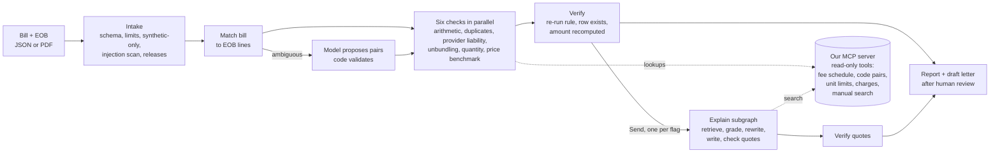

# Medical Bill Auditor

An AI system that checks a US doctor's (professional) medical bill, and the insurer's explanation of benefits (EOB) if there is one, for possible billing errors. Every finding comes from a deterministic rule, cites the table row or verbatim manual passage it rests on, and is re-checked by code before it is reported. A language model is used only where reading text helps: pairing bill lines with EOB lines when only the descriptions tell them apart, and writing plain-language explanations grounded in the NCCI Policy Manual.

> **Research prototype.** Not legal or financial advice. Synthetic test bills only: never use it on a real bill. Confirm any possible error with the billing office and the insurer.

Built with LangGraph (agent workflow), corrective RAG over the NCCI Policy Manual (hybrid BM25 + vector retrieval), its own MCP server for all evidence lookups, and Google Gemini (free tier). Python 3.11, managed with uv.

## Results

All numbers are measured on synthetic bills (300 generated plus 48 hand-written hard cases). Development and held-out splits; the held-out split was scored only at milestone ends. Full write-ups are in [`docs/results/`](docs/results/).

**Four systems on the same held-out sample** (75 bills, Milestone 4):

| System | Every flag on the bill right | Error recall | Error precision | False alarms on clean bills |
| --- | --- | --- | --- | --- |
| A. Model alone (bill in the prompt, no tools) | 45% | 0.67 | 0.43 | 32% |
| B. Rules only (the LangGraph workflow, no model) | 99% | 0.98 | 1.00 | 0% |
| C. Single ReAct agent with the same tools | 75% | 0.87 | 0.91 | 0% |
| **D. Full system** (workflow + model for matching and explanations) | **100%** | **1.00** | **1.00** | **0%** |

All three pre-registered contrasts are significant after Holm correction:

- C beats A: tools help a model.
- D beats C on 19 bills and loses on none: structure beats a free tool loop, because the agent skipped lookups it needed.
- C's precision is higher than A's.

| Measure | Result |
| --- | --- |
| Full system on all 105 held-out bills: recall, precision, dollar recall | 1.00, 1.00, 1.00 (rules only: 0.985, 1.00, 0.968) |
| Evidence validity: every quote in an explanation verified verbatim against the manual | 100% (29/29 held-out, 57/57 development) |
| Retrieval on 47 labelled queries, hit@5 / MRR | hybrid 1.00 / 0.93, vector 0.98 / 0.91, keyword 0.94 / 0.85 |
| The grader declines when the manual has no answer | 23/23 unanswerable questions refused, 1/23 answerable wrongly refused |
| MCP migration: tool outputs byte-identical to direct calls | 4,224/4,224 lookups; the whole evaluation replays with 0 new model calls |
| Adversarial suite: injection, PII smuggling, malformed input | 30/30 passed live; 0 wrong flags, 0 personal values sent |
| PDF bills: line items read back exactly | 1,433/1,433 |

**Read these numbers with care.** Generated bills are built from the same written rules the checks use, so near-perfect rule scores are expected there. The hard cases are where systems differ. The code-pair and unit-limit tables are **synthetic**, so results for those two checks are on made-up rules (see the licence notice below). Synthetic bills are cleaner than real ones: this shows the system works on well-formed professional claims, not on any bill.

## How it works



- **Deterministic first.** The six checks are code over versioned tables, so they cannot hallucinate. The model only reads text the rules cannot (body side, body part), and every pair it proposes is validated by code.
- **Corrective RAG.** Each finding gets a manual passage through retrieve, grade (with up to two query rewrites) and write. Every quote must match the manual verbatim, or the explanation is regenerated once and then dropped.
- **Verify everything.** A flag survives only if its rule re-runs, its table row exists and its amount is recomputed independently.
- **MCP.** All evidence lookups go through our own read-only MCP server over stdio. The client pins the server's tool fingerprint, which defends against tool poisoning.
- **Guardrails** (Milestone 6):
  - input limits; synthetic bills only;
  - an injection detector, and suspect text is never shown to the model;
  - redaction plus a pre-send PII gate on every model call;
  - neutral wording: no accusations, no medical-necessity opinions, no legal advice;
  - step budgets, timeouts and spending caps;
  - letters only from verified high-confidence findings, after a human review.

Design decisions with alternatives and trade-offs are in [`docs/decisions/`](docs/decisions/); the full plan is [`PLAN.md`](PLAN.md).

## Run it yourself

Tested on Windows 11; the same steps work on macOS and Linux with that system's paths.

**1. Install uv and get the code**

Install [uv](https://docs.astral.sh/uv/getting-started/installation/), then:

```
git clone https://github.com/YashKamerkar14/medical-bill-auditor.git
cd medical-bill-auditor
```

**2. Make a data folder outside the repository** (it will hold the CMS downloads, SQLite and the vector index), for example `C:\dev\bill-auditor-data` (Windows) or `~/bill-auditor-data` (macOS/Linux). Copy `.env.example` to `.env` and set `DATA_DIR` to that folder. If your clone is inside OneDrive, Dropbox or iCloud, also set the environment variable `UV_PROJECT_ENVIRONMENT` to `<DATA_DIR>/.venv`, so the virtual environment is not synced.

**3. Install** (uv fetches Python 3.11 and the exact pinned versions from `uv.lock`):

```
uv sync
```

**4. Download the public CMS files yourself** into `<DATA_DIR>/raw/`. This step is manual on purpose: some CMS pages ask you to accept a licence, and only you can decide that.

- `raw/pfs/`: the four 2026 PFREV ZIPs (PFREV26A, B, C and D) from the CMS [PFS National Payment Amount File](https://www.cms.gov/medicare/payment/fee-schedules/physician/national-payment-amount-file) page.
- `raw/manual/`: the 2026 NCCI Policy Manual Chapter I and Chapter XI PDFs from the CMS [NCCI Policy Manual](https://www.cms.gov/medicare/coding-billing/national-correct-coding-initiative-ncci-edits/medicare-ncci-policy-manual) page. The exact file names are in `src/bill_auditor/ingest/sources.py`.
- `raw/charges/`: `MUP_PHY_R26_P05_V10_D24_Geo.csv` from the CMS [Physician & Other Practitioners: by Geography and Service](https://data.cms.gov/provider-summary-by-type-of-service/medicare-physician-other-practitioners/medicare-physician-other-practitioners-by-geography-and-service) page (data year 2024).

**5. Build the tables and indexes** (a few minutes; the first run also downloads a 67 MB local embedding model):

```
uv run python scripts/build_data.py
```

**6. Check it works:**

```
uv run pytest
```

Unit tests use fake fixtures and run without any data; acceptance tests run on your real tables.

**7. Audit an example bill.** `examples/` holds synthetic bills as JSON and PDF; [`examples/index.json`](examples/index.json) says what each contains and what the right answer is.

```
uv run python -m bill_auditor.audit examples/hard-i01-bill.pdf
uv run python -m bill_auditor.audit examples/hard-m01-bill.pdf --eob examples/hard-m01-eob.pdf
uv run python -m bill_auditor.audit examples/hard-t02-bill.json --letter draft.txt --i-have-reviewed
```

**8. Or use the app:**

```
uv run streamlit run src/bill_auditor/ui/app.py
```

Pick an example or upload a synthetic bill (JSON or PDF), run the audit, read the report, then tick the items you checked and confirm your review to draft a letter.

**Optional: the full system.** Rules-only mode needs no key and costs nothing. The full system (model-assisted matching and manual explanations) needs a free Google AI Studio key: put `GOOGLE_API_KEY` in `.env` and choose "Full system" in the app, or add `--full` on the command line. Keep the key on the free tier (do not enable billing). Calls are capped per session and per day, cached, and made only with redacted synthetic bills.

## Reproduce the evaluation

| What | Command |
| --- | --- |
| Generate the synthetic test set (deterministic) | `uv run python scripts/generate_cases.py` |
| Rules only, scored | `uv run python -m bill_auditor.evaluation.run_eval score-rules --split heldout` |
| Full system, scored (free tier, cached, resumable) | `uv run python -m bill_auditor.evaluation.run_eval score-full --split heldout` |
| Model-alone baseline (free tier, resumable), then scored | `uv run python -m bill_auditor.evaluation.run_eval run-baseline --split heldout` and `uv run python -m bill_auditor.evaluation.run_eval score --split heldout` |
| Retrieval experiment | `uv run python -m bill_auditor.evaluation.run_eval score-retrieval` |
| ReAct agent, then the A/B/C/D comparison | `uv run python -m bill_auditor.evaluation.run_eval run-react --part heldout_scored` and `uv run python -m bill_auditor.evaluation.run_eval score-m4 --part heldout_scored` |
| MCP parity (byte-identical lookups, zero-call replay) | `uv run python -m bill_auditor.evaluation.run_eval mcp-parity` |
| Adversarial suite, live | `uv run python -m bill_auditor.evaluation.run_eval red-team` |
| PDF accuracy | `uv run python -m bill_auditor.evaluation.run_eval pdf-accuracy` |

Commands that use the model need `GOOGLE_API_KEY`. Saved answers are reused, so re-running costs nothing.

## Repository layout

```
src/bill_auditor/
  ingest/       load CMS tables, chunk and index the manual
  tables/       exact lookups: fee schedule, code pairs, unit limits, charges (release-aware)
  retrieval/    keyword (SQLite FTS5), vector (Chroma), hybrid (RRF)
  lookups.py    the evidence interface: direct or over MCP
  mcp_server/   our MCP server (read-only tools, manual resources)
  mcp_client.py pinned MCP client
  parsing/      bill/EOB schemas, intake, redaction, PDF
  checks/       the six deterministic checks
  agent/        LangGraph graph, AI matching, explain subgraph, tracing
  guardrails/   verify, quotes, wording, PII gate, injection detector
  letter/       dispute letter drafts
  baselines/    model alone, rules only, full system, ReAct agent
  evaluation/   generator, hard cases, metrics, statistics, experiments, red team
  ui/           command-line core and the Streamlit app
synthetic_tables/  the synthetic code-pair and unit-limit rules (fake Z-codes)
eval/              hard cases, labelled queries, locked samples, result files
docs/decisions/    architecture decision records (ADRs)
docs/results/      one write-up per milestone
```

## Scope and limitations

- In scope: US professional claims (CMS-1500 style), insured (bill + EOB) and self-pay bills, the six checks, public Medicare data.
- Out of scope, reported as "cannot check": hospital (UB-04) bills, unknown codes, and dates outside the loaded table release. Also out of scope: medical necessity or whether a visit was coded too high (both need clinical records), and legal or financial advice. The system never sends anything: letters are drafts.
- The PDF reader handles this project's synthetic statement layout, not arbitrary real-world PDFs.
- No public hosted demo, by design: it must never receive a real bill.

## Licence notice

CPT codes and descriptors are copyright of the American Medical Association. This repository contains **no** CMS table rows, CPT descriptors or anything derived from them: you download the public CMS files yourself. No licence-gated file is used. The code-pair (PTP) and unit-limit (MUE) tables are **synthetic**: made-up rules over fake `Z` codes, in `synthetic_tables/`. Every result and report that depends on them says so.
